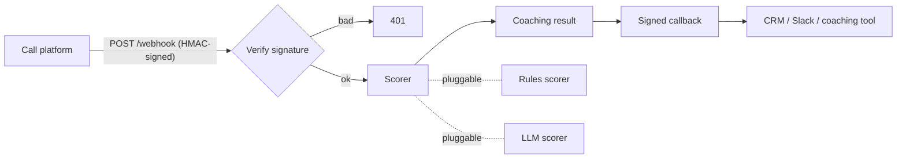

# Call Coaching Webhook Demo

A small, working integration: a call transcript arrives by webhook, gets scored against a coaching rubric, and the result is delivered to a callback URL, signed so the receiver can verify it.

It's the shape of a typical solution-architecture build: **event in, logic, event out**, with security and failure handling treated as part of the design. Standard library only, no installs.

> All transcripts are fictional. No employer, vendor, or customer material is used here.

## Architecture



| Piece | What it does | Why it's designed this way |
|---|---|---|
| `coach/server.py` | Webhook endpoint, HMAC signature check, signed callback | Inbound and outbound are both verifiable. A failed callback is reported in the response and never fails the scoring. |
| `coach/scorer.py` | Two scorers with one result shape | The rules scorer is deterministic and works offline. The LLM scorer is swappable via one flag. |
| `coach/rubric.json` | The rubric: five weighted dimensions | Coaching logic lives in data, not code. A manager can change it without touching Python. |
| `tests/` | 17 tests including auth, the LLM parser, and the eval harness, with the model call mocked | The LLM path is tested without a network or a key. |
| `evals/` | 16 labeled calls and a runner that scores any scorer against the labels | Answers "is the scorer any good?" with numbers instead of an opinion. |

## Quickstart

```bash
python3 -m unittest discover -s tests        # 17 tests
python3 -m coach score samples/transcript_mixed.txt
```

Run the server with signature checking on:

```bash
COACH_WEBHOOK_SECRET=demo python3 -m coach serve --port 8099
```

Send a signed request from another terminal:

```bash
BODY='{"call_id":"demo-1","transcript":"Seller: What does it cost you?\nBuyer: About 3 million a year."}'
SIG=$(python3 -c "import hmac,hashlib,sys;print('sha256='+hmac.new(b'demo',sys.argv[1].encode(),hashlib.sha256).hexdigest())" "$BODY")
curl -s -X POST localhost:8099/webhook -H "X-Signature: $SIG" -d "$BODY"
```

The same request without the header returns `401`.

To have results pushed somewhere, add `"callback_url"` to the payload or set `COACH_OUTBOUND_URL`. Callbacks carry the same `X-Signature` scheme.

## Sample output

Three fictional calls, scored by the rules scorer:

| Sample | Overall | Pain | Metrics | Economic buyer | Decision process | Next step | Top gap |
|---|---|---|---|---|---|---|---|
| `transcript_weak.txt` (feature tour, no questions) | 0 | 0 | 0 | 0 | 0 | 0 | Pain and impact |
| `transcript_mixed.txt` (found pain, stopped there) | 42 | 100 | 50 | 0 | 50 | 0 | Economic buyer |
| `transcript_strong.txt` (discovery-first) | 100 | 100 | 100 | 100 | 100 | 100 | none |

The weak call also shows the classic coaching signal: the seller spoke **93%** of the words and asked **0** questions.

## Using the LLM scorer

```bash
export ANTHROPIC_API_KEY=...
python3 -m coach score samples/transcript_mixed.txt --scorer llm
```

It sends the transcript and rubric to the model and requires JSON back. Scores are clamped to 0-100, and a response that omits any rubric dimension is rejected rather than guessed at. Model defaults to `claude-sonnet-5-5`; override with `ANTHROPIC_MODEL`.

## Does the scorer actually work? The eval

```bash
python3 -m evals.run_eval --scorer rules     # offline
python3 -m evals.run_eval --scorer llm       # needs ANTHROPIC_API_KEY; prints agreement, errors, tokens, time
```

16 fictional calls, each labeled per dimension as 0 (absent), 50 (partial), or 100 (clear). Agreement means within 25 points of the label.

| Scorer | Agreement | Mean abs. error | False positives | Misses |
|---|---|---|---|---|
| Keyword rules (measured) | 68% | 27.7 | 10 | 8 |
| LLM | not run yet | | | |

The keyword baseline fails where you would expect: it scores a seller's monologue as a perfect call, reads "no real problem, no budget" as pain and budget, accepts "book a time whenever" as a next step, and misses a real next step phrased without its keywords. Details are in [`evals/README.md`](evals/README.md). The LLM row stays empty until the run is done, so nothing here is invented.

## Honest limits

- **The rules scorer is a baseline, not a judge.** It counts keywords, so it can be gamed and it misses nuance. That's why the scorer is pluggable and why the LLM scorer exists.
- **The strong sample is written to hit the rubric**, so its 100 shows the rubric works as intended, not that the scorer is accurate on real calls. A real deployment would validate scores against calls a human coach has already rated.
- **The LLM scorer has only been tested with a mocked model response**, not against the live API. The eval exists to change that: run it, and the table above gets a real number.
- **The eval set is small and I wrote it.** 16 calls, one labeler, and about half are built to expose keyword weaknesses, so the baseline looks worse than it would on typical calls. It shows where each scorer fails, not how accurate either is in production.
- **Not production-ready:** no retries or queue on callbacks, no replay protection (a timestamp in the signed payload would add it), single-threaded server. Each is a deliberate omission to keep the demo readable.

## What I'd add for a real customer

1. A queue between the webhook and the scorer, so a slow model call never blocks the sender.
2. Retries with backoff on callbacks, and a dead-letter store.
3. A timestamp in the signature to stop replays.
4. A calibration set: 20 human-scored calls to measure scorer agreement before anyone is coached on the output.

## Author

Alberto Escalante · [LinkedIn](https://www.linkedin.com/in/albertoantonioescalante/)
